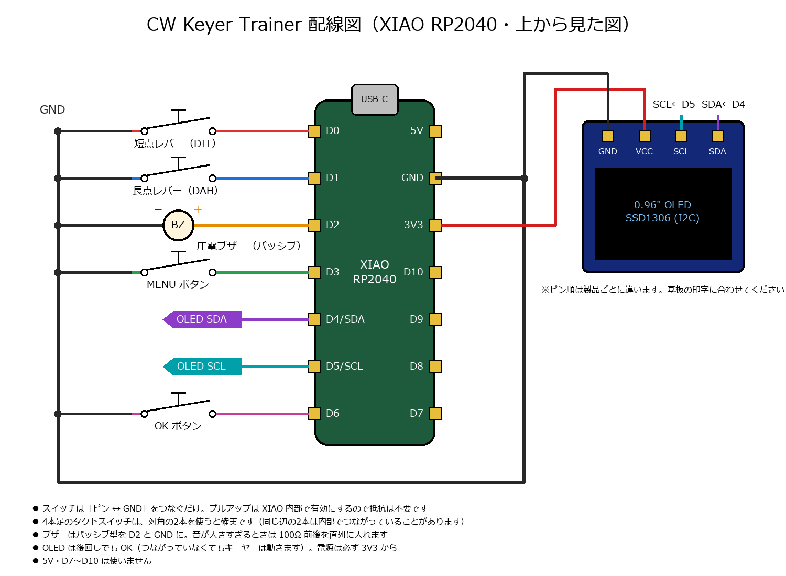

# CW Keyer Trainer

English | [日本語](README.md)

An electronic keyer and a training app for practicing Morse code (CW), both sending and receiving.

- **Keyer**: an iambic keyer built on a Seeed XIAO RP2040 with a commercial paddle. The sidetone buzzer has no latency, and you can practice with just the OLED and buttons.
- **Training app**: a PWA (installable web app that also works offline) for iPhone and PC.

## Features

| Practice | What you do | Device |
|---|---|---|
| Receive | Koch method, callsigns, and rubber-stamp QSOs | Not needed |
| Written | Code ↔ character (exam prep) | Not needed |
| Send | Key the prompt → decoded text, dit:dah ratio and spacing errors | Needed |
| Echo | Key back what you heard | Needed (works on the device alone too) |
| Settings | Read/write the device's WPM, mode and tone | Needed (PC only) |

Connection: on PC via USB serial (Web Serial, Chrome / Edge); on iPhone as a USB keyboard (the keyer output is sent as the F13 key).

Note: the app UI is in Japanese.

## Open the app

- **iPhone / PC**: https://kajiyajp.github.io/cw-keyer-trainer/
- **Run locally on PC** (requires [Node.js](https://nodejs.org/)):

```powershell
./tools/serve.ps1
```

Then open http://localhost:8000/ in Chrome / Edge (use `-Port 8001` for another port).

## Parts

| Part | Details |
|---|---|
| MCU | Seeed XIAO RP2040 |
| Display | 0.96" OLED SSD1306 (I2C, 4 pins) |
| Buzzer | Passive piezo buzzer |
| Buttons | 2 tactile switches (MENU / OK) |
| Paddle jack | 3.5mm stereo jack (tip = dit, ring = dah, sleeve = GND) |
| Paddle | Any commercial paddle with a 3.5mm stereo plug |

## Wiring



| Pin | Use |
|---|---|
| D0 / D1 | Dit / dah (internal pull-up, closes to GND) |
| D2 | Buzzer (PWM) |
| D3 / D6 | MENU / OK buttons |
| D4 / D5 | OLED SDA / SCL |

## Flash the firmware

Uses [PlatformIO](https://platformio.org/).

```powershell
cd firmware
pio run -t upload
```

If upload fails, hold the XIAO's BOOT button while reconnecting USB, then try again.

Tests:

```powershell
cd firmware
pio test -e native
```

```powershell
cd app
npm test
```

## Case

Coming soon (STEP / STL files for 3D printing).

## Documents

- [Design document](docs/cw-trainer-design.md) (Japanese)
- [HID key test page](tools/hid_test.html) (download and open it in a browser to check that F13 reaches the iPhone)

## License

[MIT](LICENSE)
