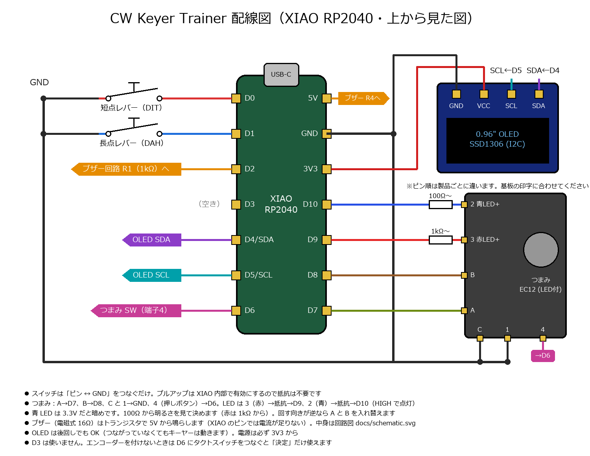
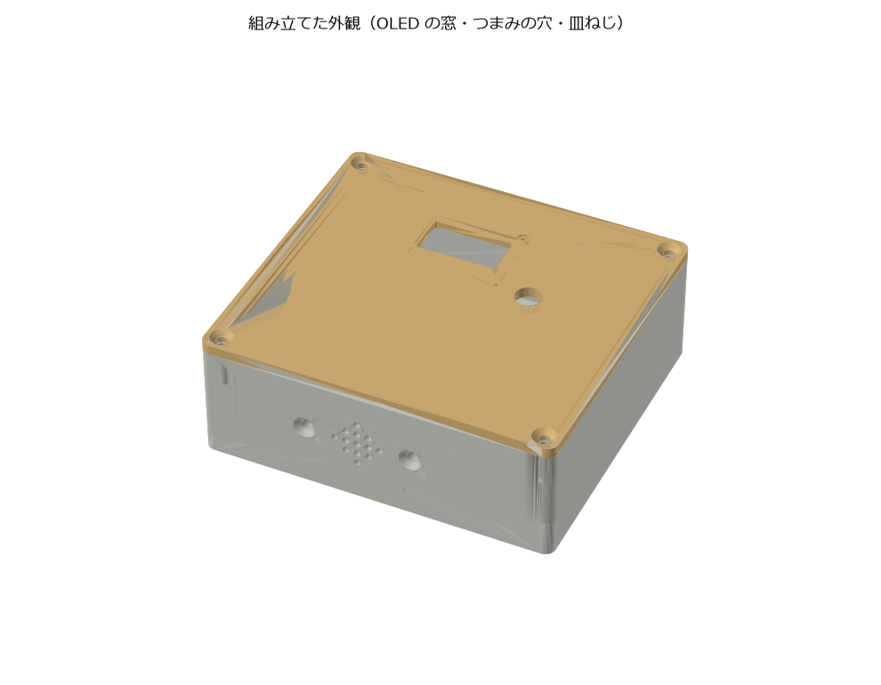

# CW Keyer Trainer

[English](README.en.md) | 日本語

モールス符号（CW）を「打つ」「聞く」の両方で練習するための、エレキー（電子キーヤー）と練習アプリのセットです。

- **エレキー**：Seeed XIAO RP2040 に市販のパドルをつなぐ iambic キーヤー。圧電サウンダで遅延なく鳴り、OLED とつまみ（LED 付きロータリーエンコーダー）だけでも練習できます
- **練習アプリ**：ブラウザで動く PWA（ホーム画面に追加でき、オフラインでも動く Web アプリ）。iPhone と PC で使えます

## できること

| 練習 | 内容 | 機器 |
|---|---|---|
| 受信 | Koch 法・コールサイン・定型 QSO を聞いて答える | 不要 |
| 筆記 | 符号 ↔ 文字（試験対策） | 不要 |
| 送信 | 出題文を打つ → 解読結果と、短点:長点比・字間のずれを表示 | 必要 |
| エコー | 聞いた符号を打ち返す | 必要（本体だけでも可） |
| 設定 | 機器の WPM・モード・トーンを読み書き | 必要（PC のみ） |

機器との接続：PC は USB シリアル（Web Serial。Chrome / Edge）、iPhone は USB キーボード（キーヤーの出力を F13 キーとして送る）。

## アプリを開く

- **iPhone・PC**：https://kajiyajp.github.io/cw-keyer-trainer/
- **PC でローカルに起動**（[Node.js](https://nodejs.org/) が必要）：

```powershell
./tools/serve.ps1
```

→ http://localhost:8000/ を Chrome / Edge で開きます（ポートを変えるときは `-Port 8001`）。

## 部品

| 部品 | 内容 |
|---|---|
| マイコン | Seeed XIAO RP2040 |
| 表示 | 0.96 インチ OLED SSD1306（I2C、4 ピン） |
| 圧電サウンダ | パッシブ型（発振回路なし）。音が大きすぎるときは 2.2k〜10kΩ を直列に入れる |
| つまみ | 押しボタン・2色 LED 付きロータリーエンコーダー（秋月電子 P-05772、EC12 24 クリック）＋ DIP 化基板（P-07240）。LED 用の抵抗：赤 1kΩ・青 100Ω から |
| パドル接続 | 3.5mm ステレオジャック（先端＝短点、リング＝長点、根元＝GND） |
| パドル | 市販のパドル（3.5mm ステレオプラグ） |

## 配線



ユニバーサル基板（秋月 104303、ブレッドボード配線パターン 80 × 50 mm）で組むときの実体配線図：[表（部品面）](docs/board_front.png)・[裏（はんだ面）](docs/board_back.png)

**回路図（KiCad 10）・部品表・組み立ての順番**は [docs/hardware.md](docs/hardware.md) にまとめています。

| ピン | 用途 |
|---|---|
| D0 / D1 | 短点 / 長点（内部プルアップ、押すと GND） |
| D2 | 圧電サウンダ（PWM） |
| D3 | 空き |
| D4 / D5 | OLED SDA / SCL |
| D6 | つまみの押しボタン（端子4。内部プルアップ、押すと GND） |
| D7 / D8 | つまみの A / B（内部プルアップ。C と端子1は GND）。回す向きが逆なら入れ替える |
| D9 / D10 | つまみの赤 LED（端子3）/ 青 LED（端子2）。抵抗を通してつなぐ（HIGH で点灯） |

**つまみの操作**：回す＝項目を選ぶ・値を変える、押す＝決定、長押し＝メニューに戻る。LED はエコー練習の正解で青・不正解で赤が光り、設定画面の間は赤が点きます（サイドトーン OFF のときは打鍵中に青）。エンコーダーを付けないときは、D6 にタクトスイッチをつなげば「決定」だけ使えます。

## ファームウェアを書き込む

[PlatformIO](https://platformio.org/) を使います。

```powershell
cd firmware
pio run -t upload
```

書き込めないときは、XIAO の BOOT ボタンを押しながら USB をつなぎ直してから実行します。

テスト：

```powershell
cd firmware
pio test -e native
```

```powershell
cd app
npm test
```

## ケース

3D プリント用のケース（外形 99.5 × 91 × 35.7 mm、上のユニバーサル基板ごと収める。部品とのすき間 10 mm 以上（USB 側は 2 mm）、固定は M3 皿ねじ）の STL・STEP、全部品を組み付けた STEP と、寸法を変えて作り直せるスクリプトを [case/](case/README.md) に置いています。



## ドキュメント

- [設計書](docs/cw-trainer-design.md)
- [HID キーの確認ページ](tools/hid_test.html)（ダウンロードしてブラウザで開き、iPhone で F13 が届くか確かめる）

## ライセンス

[MIT](LICENSE)
