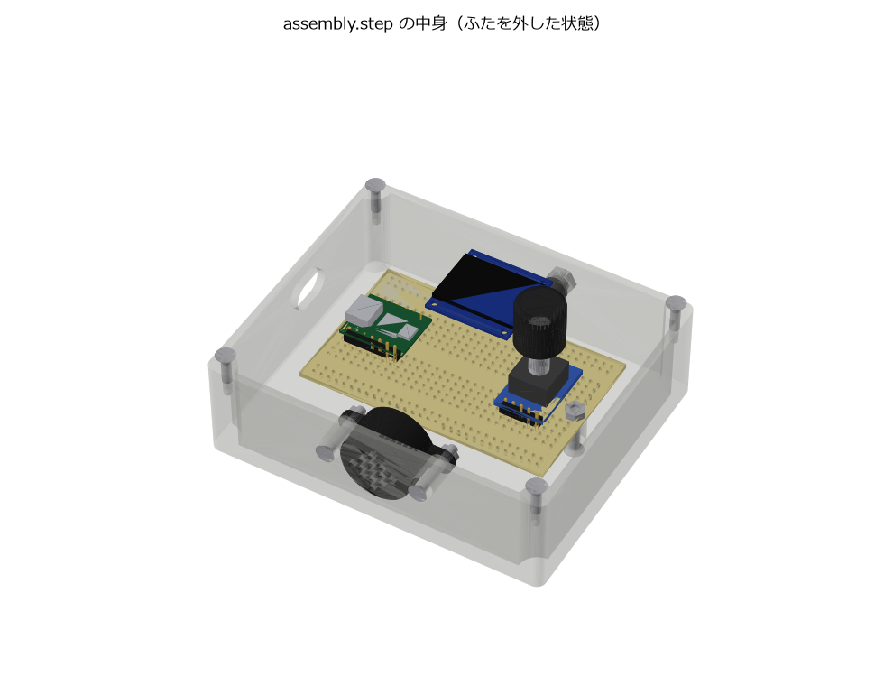

# ケース（3D プリント）

底ケースとふたの2つに分かれた、ユニバーサル基板ごと収めるケースです。外形は **109 × 91 × 35.7 mm**。

- **大きめに作り、基板・部品とケースのすき間を 10 mm 以上**あけています（配線や手を入れる余裕）
- **固定ねじはすべて M3 皿ねじ**。頭が表面と面一になるよう皿もみしてあります
- ブザー（耳付きのパネル取付型）は**手前の壁**に付け、壁の音穴から鳴らします


## ファイル

| ファイル | 内容 |
|---|---|
| [out/assembly.step](out/assembly.step) | **全部品を組み付けた状態**（ケース・基板・XIAO・ピンヘッダー・つまみ・OLED・ブザー・ジャック・ねじ・ナット、色付き） |
| [out/case_base.stl](out/case_base.stl) / [out/case_lid.stl](out/case_lid.stl) | 印刷用（ふたは上面を下にした向きで書き出し済み） |
| [out/case_base.step](out/case_base.step) / [out/case_lid.step](out/case_lid.step) | ケースだけ（ほかの CAD で編集する用） |
| [case.py](case.py) | 形を作るスクリプト（CadQuery）。寸法は先頭の数値で変えられる |
| out/preview_*.png | 確認用の画像 |



assembly.step の部品名（英数字。ほかの CAD で文字化けしないため）：`case_base` `case_lid` `board_akizuki_104303` `xiao_rp2040_pcb` `xiao_rp2040_parts` `pin_header_plastic` `pin_header_pins` `encoder_adapter_recnv2` `encoder_ec12` `encoder_shaft` `knob` `oled_pcb` `oled_glass` `buzzer` `jack_3p5mm_trs` `jack_nut` `lid_screw_m3x10_1〜4` `board_screw_m3x16` `board_nut_m3` `buzzer_screw_m3x20_1〜2` `buzzer_nut_m3_1〜2`

部品の形は、外形と取付位置を合わせた簡単なものです（XIAO のチップ、つまみの形などはおおよそ）。

## 部品

| 部品 | 型番など | 場所 | 寸法（case.py の値） |
|---|---|---|---|
| ユニバーサル基板 | 秋月 104303（ブレッドボード配線パターン） | 底ケースの台 | 80 × 50 × 1.6 mm、取付穴 2 つ |
| マイコン | Seeed XIAO RP2040 | 基板の D・H 行 2〜8 列。USB-C を左の壁の穴へ | 21 × 17.5 mm |
| つまみ | 秋月 P-05772（EC12）＋ DIP 化基板 P-07240 | 基板の C・I 行 23〜27 列。軸をふたの穴から出す | 付属のつまみは φ15 × 15 mm と仮定 |
| OLED | ASIN B0HGLXK9TW（0.96 インチ、SSD1315、I2C 4 ピン） | ふたの裏の奥の中央。線を J14〜J17 へ直接はんだ付け | 27 × 27 mm（商品ページの値）。取付穴の間隔は仮 |
| ブザー | ASIN B0CZJ5DGDH（電子ブザー、DC 3〜24V、耳付き） | **手前の壁**。リード線を A13（赤）と下の−レール（黒）へ | φ23 × 13 mm、耳の穴の間隔 30 mm（写真からの推定） |
| ジャック | 3.5 mm ステレオ（TRS、3 端子）、パネル取付 | 奥の壁 | M6 ねじ（穴 φ6.3）と仮定 |

実体配線図：

| 表（部品面） | 裏（はんだ面） |
|---|---|
|  |  |

ブザー（B0CZJ5DGDH）は今のファームウェア（`tone()` で鳴らす）のままで使え、TONE の設定も効くことを実機で確かめています。R1 は音量調整用で、いらなければジャンパー線にします。

## すき間

| どこ | すき間 |
|---|---|
| 基板 → 壁・四隅の柱 | 11 mm（基板と左・右・奥の壁の間は 12 mm） |
| 基板 → ブザー | 11 mm（基板と手前の壁の間は 24 mm） |
| XIAO・DIP 化基板・エンコーダー → 壁・柱・ブザー | 15 mm 以上 |
| XIAO → ふた・OLED | 10 mm |
| 基板の裏（はんだ面）→ 床 | 10 mm |
| エンコーダー本体 → ふた | **7 mm（例外）**：軸がふたを通るので、軸の長さ（18 mm）− つまみがはまる長さ（8 mm）− ふたの厚さ（3 mm）で決まる |

## ねじと固定（すべて M3 皿ねじ）

| 場所 | ねじ | 留め方 |
|---|---|---|
| ふた（四隅） | M3 × 10 皿ねじ 4 本 | 四隅の柱の下穴（φ2.5）に直接ねじ込む |
| 基板（30 列目の取付穴） | M3 × 16 皿ねじ ＋ ナット | 底の裏から通し、基板の上でナットを締める |
| 基板（1 列目の取付穴） | なし | XIAO の下になるので位置決めピンに差すだけ |
| ブザー（耳 2 つ） | M3 × 20 皿ねじ ＋ ナット 2 組 | 手前の壁の外から通し、壁の台を通って耳の裏でナットを締める |

- 皿もみは JIS の M3 皿小ねじ（頭 φ6、90°）に合わせて φ6.4 にしています
- 柱の下穴に小ねじを何度も締め直すとねじ山が傷みます。気になるときは M3 インサートナットを使い、`M3_TAP_D` を 4.0 mm 前後に変えて作り直してください

## 組み立て

1. 実体配線図のとおりに基板を作る。OLED の線（4 本、10 cm ほど）、ジャックの線（3 本）、ブザーのリード線は長めにしておく
2. 基板の 1 列目の取付穴を底ケースのピンに差し、30 列目を底の裏から M3 × 16 皿ねじで通して、基板の上でナットを締める
3. ブザーの音の面を手前の壁の内側に当て、壁の外から M3 × 20 皿ねじ 2 本を通して耳の裏でナットを締める
4. ジャックを奥の壁の穴に通してナットで締める
5. OLED をふたの裏のピンに差し、ガラスをくぼみに合わせる。ピンの先をはんだごてで軽くつぶすか、接着剤で留める
6. ふたをかぶせ（つまみの軸を穴に通す）、四隅を M3 × 10 皿ねじ 4 本で留める
7. つまみを軸に差す。一度奥まで押し込むと外れない作りなので、位置を確かめてから押し込む

## 印刷の目安

- 材料は PLA か PETG、積層 0.2 mm、壁 3 周、充填 20 % 程度
- 底ケースは床を下に、ふたは上面を下にして印刷する。手前の壁の音穴・皿もみと、ブザーの台はサポートなしで印刷できる向き

## 作り直すとき

リポジトリのルートで実行します（[uv](https://docs.astral.sh/uv/) が必要。初回は CadQuery を自動で入れます）。

```powershell
uv run --no-project --python 3.12 --with cadquery --with matplotlib python case/case.py
```

外形・ねじ・**干渉チェック**・**すき間**を表示し、`out/` の STEP（組み立てを含む）・STL・画像を書き直します。実体配線図は `python tools/board_layout.py` で作り直せます。

## 実物で確かめること

- **ブザー**：本体の直径・高さ、耳の穴の間隔（`BUZ_*`）は写真からの推定です。測って直してください
- **OLED**：取付穴の間隔（`OLED_HOLE_DX/DY`）とガラスの位置（`OLED_GLASS_DY`）
- **つまみ**：付属のつまみの寸法（`KNOB_D/H`）と、はまる深さ（`KNOB_GAP`）
- **ジャック**：穴径（`JACK_HOLE_D`）と本体の長さ
- **XIAO の高さ**：USB-C 穴の高さはピンヘッダーの樹脂の高さ（`HEADER_H`）で決まります
