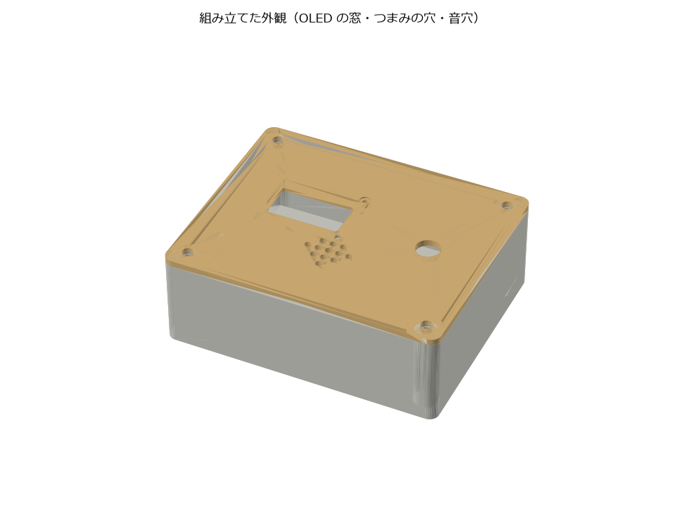
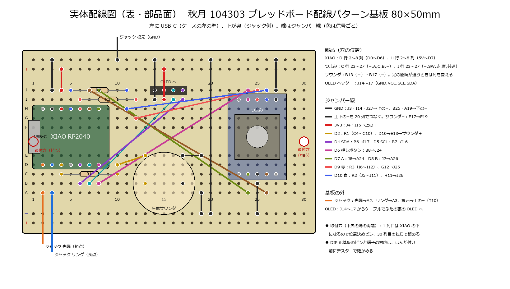
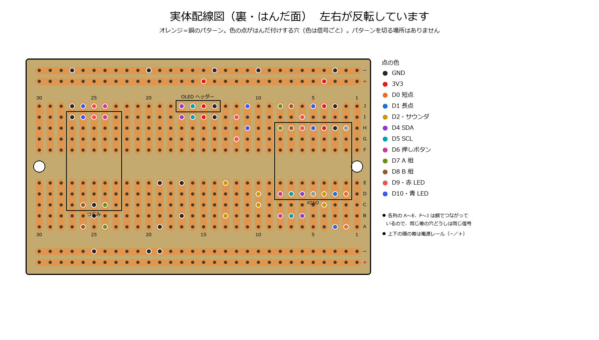

# ケース（3D プリント）

底ケースとふたの2つに分かれた、ユニバーサル基板ごと収めるケースです。外形は **85 × 69 × 29.7 mm**。



| ファイル | 内容 |
|---|---|
| [out/case_base.stl](out/case_base.stl) / [out/case_lid.stl](out/case_lid.stl) | 印刷用（ふたは上面を下にした向きで書き出し済み） |
| [out/case_base.step](out/case_base.step) / [out/case_lid.step](out/case_lid.step) | ほかの CAD（FreeCAD・Fusion など）で編集する用 |
| [case.py](case.py) | 形を作るスクリプト（CadQuery）。寸法は先頭の数値で変えられる |
| out/preview_*.png | 確認用の画像（組み立て・底ケース・ふたの裏） |

## 基板と部品の配置

基板は **秋月電子 104303（片面ガラス・ユニバーサル基板 ブレッドボード配線パターンタイプ、80 × 50 mm）** を使います。部品の位置と配線は実体配線図のとおりです。

| 表（部品面） | 裏（はんだ面） |
|---|---|
|  |  |

| 部品 | 基板の穴 | ケースでの位置 |
|---|---|---|
| XIAO RP2040 | D 行・H 行の 2〜8 列（ピンヘッダーで浮かせる） | USB-C を左の壁の穴へ |
| つまみ（EC12 ＋ DIP 化基板 RECNV-2） | C 行・I 行の 23〜27 列（ピンヘッダーで浮かせる） | 軸をふたの穴から出す |
| 圧電サウンダ | B13・B17 | 真上のふたに音穴 |
| OLED 0.96 インチ | 線を J14〜J17 にはんだ付け | ふたの裏（ガラスを窓から見せる） |
| 3.5 mm ステレオジャック | 線を A2・A3・上の−レールへ | 奥の壁（パネル取付、M6 ねじ） |

基板の取付穴は中央の溝の両端（1 列目と 30 列目）の2つだけです。1 列目は XIAO の下になってねじを回せないので、底ケースの**位置決めピン**に差し、30 列目を**ねじ**で留めます。ふたは基板の前後に置いた四隅の柱にねじで留めます。

## 組み立て

1. 実体配線図のとおりに基板を作る。OLED の線（4 本、10 cm ほど）とジャックの線（3 本）は長めに付けておく
2. 基板の 1 列目の取付穴を底ケースのピンに差し、30 列目を **M3 × 6 mm のタッピングねじ**で台に留める
3. ジャックを奥の壁の穴に通してナットで締める
4. OLED をふたの裏のピンに差し、ガラスをくぼみに合わせる。ピンの先をはんだごてで軽くつぶすか、接着剤で留める
5. ふたをかぶせ（つまみの軸を穴に通す）、四隅を **M3 × 8 mm のタッピングねじ** 4 本で留める
6. つまみ（エンコーダーに付属）を軸に差す。一度奥まで押し込むと外れない作りなので、位置を確かめてから押し込む

## 印刷の目安

- 材料は PLA か PETG、積層 0.2 mm、壁 3 周、充填 20 % 程度
- 底ケースは床を下に、ふたは上面を下にして印刷する（STL はその向きで書き出してある）。どちらもサポートは不要

## 作り直すとき

リポジトリのルートで実行します（[uv](https://docs.astral.sh/uv/) が必要。初回は CadQuery を自動で入れます）。

```powershell
uv run --no-project --python 3.12 --with cadquery --with matplotlib python case/case.py
```

実行すると、外形・ねじと、部品どうし・部品とケースの**干渉チェックの結果**を表示し、`out/` の STEP・STL・画像を書き直します。実体配線図は `python tools/board_layout.py` で作り直せます（部品の列を変えたときは case.py の位置も合わせる）。

## 実物で確かめること

部品の寸法の一部は、一般的な製品の値で仮に入れています。印刷する前に手元の部品と比べてください。

- **OLED**：ガラスの位置（基板の中心からのずれ `OLED_GLASS_DY`）と取付穴の間隔（`OLED_HOLE_DX/DY`）は製品ごとに違います
- **XIAO の高さ**：USB-C 穴の高さは、ピンヘッダーの樹脂の高さ（`HEADER_H`）で決まります。XIAO を基板に直付けするなら `HEADER_H` を直します
- **つまみ**：ふたの上面は、軸先のギザギザ部（7 mm）の下に 1 mm のすき間ができる高さにしています。付属のつまみがもっと深くはまるときは `KNOB_GAP` を調整します
- **圧電サウンダ**：φ17 mm・足の間隔 4 ピッチ（B13〜B17）を想定。違うときは実体配線図の列と `SOUNDER_*` を直します
- **ジャック**：型番が決まったら穴径（`JACK_HOLE_D`）と本体の長さを合わせます
