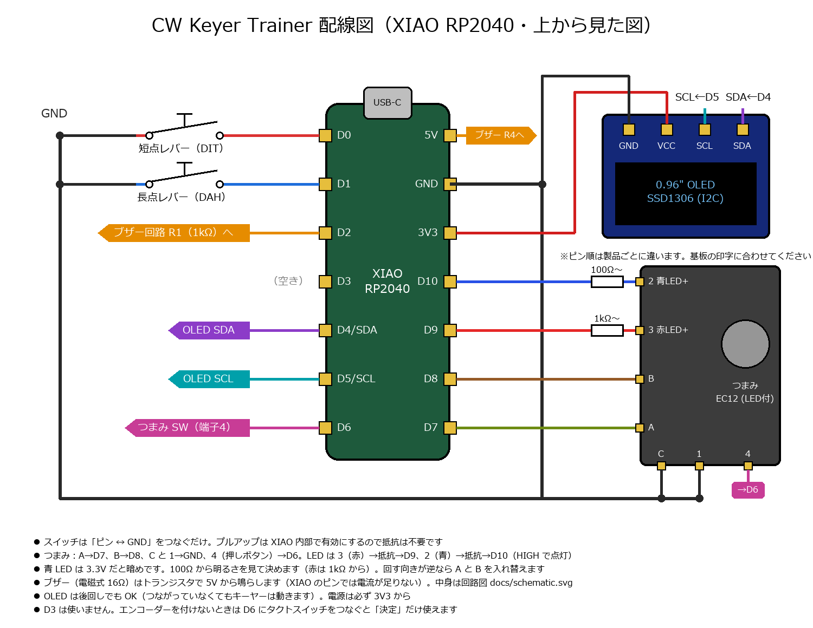
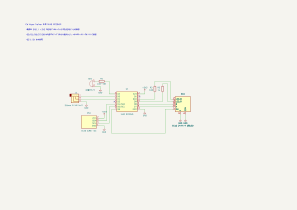
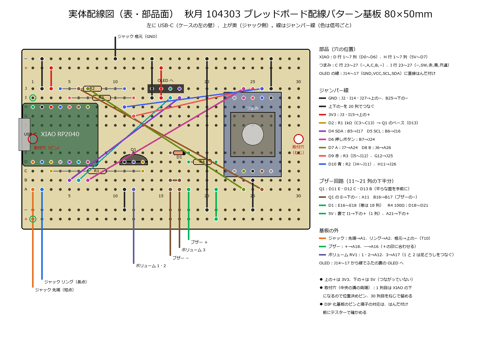
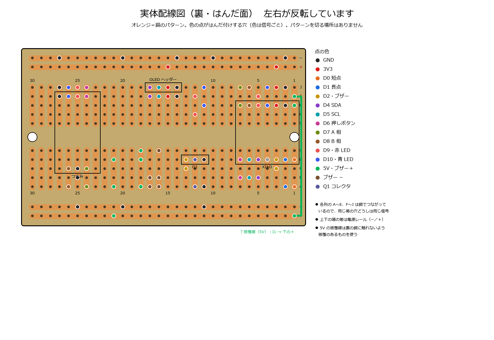

# ハードウェア（回路図・部品表・組み立て）

> 作成：2026-11-23
> 目的：エレキー本体を作る人のために、回路図・部品表・配線・組み立てを 1 か所にまとめる

CW Keyer Trainer の本体は、XIAO RP2040 に **3.5mm ジャック（パドル）・ブザー・OLED・つまみ（ロータリーエンコーダー）** をつないだ回路です。ブザーはトランジスタで鳴らします（[ブザーの回路](#ブザーの回路)）。



## 回路図



- KiCad 10 のプロジェクト：[hardware/cw-keyer.kicad_pro](../hardware/cw-keyer.kicad_pro)（KiCad で開く）
- 信号は**線（ワイヤー）**でつないでいます。電源は GND・+3V3・+5V の記号で、同じ記号どうしがつながっています
- 標準ライブラリに無い部品（XIAO RP2040・LED 付きエンコーダー・OLED モジュール）は、プロジェクト専用のライブラリ [hardware/cw-keyer.kicad_sym](../hardware/cw-keyer.kicad_sym) に入っています（`sym-lib-table` で自動で読み込まれます）
- 回路図の XIAO・OLED・つまみのピンの**並び**は、線が交差しないよう実物と変えています（XIAO の 5V は上に出しています）。ピン**番号**は実物のままです。実物の並びは下の「ピン割り当て」を見てください

### 回路図を作り直す・確かめる

回路図は [tools/make_schematic.py](../tools/make_schematic.py) が生成します。手で直すより、スクリプトを直して作り直すのがおすすめです（KiCad で直した場合は、スクリプトで作り直すと上書きされます）。

```powershell
./tools/build_schematic.ps1
```

これ 1 つで次を行い、どれか失敗したら止まります（Python と KiCad 10 が必要）。

1. 回路図を生成し、`kicad-cli sch upgrade` で KiCad 10 の形式にそろえる。生成のときに、別の信号の線どうしや、線とほかのピンが触れていないかも調べる（KiCad は接続の印が無い T 字や重なりをファイルの上ではつながっていないものとして扱うが、画面で編集すると自動でつながってショートになるため）
2. **ERC**（電気的なルールの検査）で違反が 0 件か確かめる
3. ネットリストを書き出し、[firmware/src/pins.h](../firmware/src/pins.h) から組み立てた正しい接続と 1 本ずつ突き合わせる（[tools/check_schematic.py](../tools/check_schematic.py)。ファームのピンと回路図がずれると失敗する）
4. 回路図の画像（`docs/schematic.svg`）と部品表（`hardware/bom.csv`）を書き出す

## ブザーの回路

ブザーは**電磁式**（中にコイルが入ったもの、16Ω）です。XIAO のピンに直接つなぐと約 200mA 流れようとし、ピンが出せる電流（12mA ほど）を大きく超えてしまいます。そこで NPN トランジスタ（Q1）をスイッチにして、USB の 5V から鳴らします。

```
5V ─ R4 100Ω ─┬─ ブザー(＋) ─ ブザー(−) ─┬─ RV1 1kΩB（ボリューム）─ Q1 コレクタ
              └─ D1 カソード(帯)   D1 アノード ─┘              Q1 エミッタ ─ GND
D2 ─ R1 1kΩ ─ Q1 ベース
```

- **D2 が HIGH のときに鳴ります**。ファームウェアは今までと同じ（`tone()` で D2 から PWM を出す）で、変える所はありません
- **音量は RV1**（パネル取付のボリューム、秋月 118291）で変えます。ケースの外からつまみで回せます。**1 番と 2 番（真ん中）の足をつなぎ**、抵抗の大きさだけが変わるようにしています。軸側から見て足を下にしたとき、左から 1・2・3 です。この向きでつなぐと**右に回すほど大きく**なります（逆なら 1 番と 3 番の線を入れ替える）
- **R4（100Ω）** は、RV1 を 0Ω まで回しても電流が流れすぎないようにする抵抗です（最大で約 40mA）
- RV1 の定格は 0.125W（抵抗体ぜんぶを使ったとき）です。いちばん大きい音の近くでは抵抗体の端の少しの部分に電流が集まります。そこで R4 を 100Ω にして電流を抑えています（47Ω にすると最大の音量は上がるが、ボリュームが熱を持ちやすくなる）
- **D1** はコイルの逆起電力（電流を止めた瞬間に出る逆向きの電圧）を逃がし、トランジスタを守ります。**帯（カソード）を 5V 側**に向けます
- Q1 の 2SC1815 の足は、**平らな面（文字の面）を手前に、足を下にして左から E（エミッタ）・C（コレクタ）・B（ベース）** です
- このブザーは **2kHz 付近**がいちばん大きく鳴ります。TONE は 2000Hz 前後がおすすめです
- 同じ袋のブザーでも音量に差があることがあります（印の有無で違うというレビューもあります）。鳴らし比べて大きいものを使ってください

## ピン割り当て

XIAO RP2040 を**部品面（USB-C が上）から見た並び**です。

| 左（ピン番号） | 用途 | | 右（ピン番号） | 用途 |
|---|---|---|---|---|
| D0（1） | 短点（ジャックの先端） | | 5V（14） | ブザーの電源（R4 へ） |
| D1（2） | 長点（ジャックのリング） | | GND（13） | GND |
| D2（3） | ブザー（R1 → Q1 のベース、PWM） | | 3V3（12） | OLED の VCC |
| D3（4） | 使わない（将来の拡張用） | | D10（11） | つまみの青 LED（R2 経由） |
| D4/SDA（5） | OLED の SDA | | D9（10） | つまみの赤 LED（R3 経由） |
| D5/SCL（6） | OLED の SCL | | D8（9） | つまみの B 相 |
| D6（7） | つまみの押しボタン（端子 4） | | D7（8） | つまみの A 相 |

- 入力（D0・D1・D6・D7・D8）はすべて**内部プルアップ**で、押す（閉じる）と GND に落ちます。外付けのプルアップ抵抗はいりません
- つまみのチャタリング（接点のはね）は、ファームの解読（A/B の状態の移り変わりを追う方式）で処理しているので、データシートの RC フィルタは付けていません。回して数が飛ぶときは、A・B と GND の間に 0.01µF を足してください
- 回す向きが逆なら、A と B の線を入れ替えます

## 部品表

### 電子部品（回路図から自動で書き出したもの：[hardware/bom.csv](../hardware/bom.csv)）

| 参照 | 部品 | 数 | 型番・メモ |
|---|---|---|---|
| U1 | マイコン XIAO RP2040 | 1 | Seeed Studio |
| J1 | 3.5mm ステレオジャック（3 端子、パネル取付） | 1 | 先端＝短点、リング＝長点、根元＝GND |
| BZ1 | 電磁ブザー（パッシブ型、16Ω） | 1 | KKHMF ASIN B08LB2GYD1（20 個入り）。共振 2kHz、足の間隔 6.5mm |
| Q1 | NPN トランジスタ 2SC1815 | 1 | GR ランクなど。同じ並び（E・C・B）の NPN なら代わりに使える |
| D1 | ダイオード 1S1588 | 1 | 逆起電力を逃がす。帯を 5V 側に。1N4148 でもよい |
| RV1 | ボリューム 1kΩ B カーブ（パネル取付、ラグ端子） | 1 | 秋月 118291（SH16K4B102L20KCCI、軸 6mm）。音量調整。1 番と 2 番の足をつなぐ |
| R1 | 抵抗 1kΩ | 1 | トランジスタのベース用 |
| R2 | 抵抗 100Ω | 1 | 青 LED 用。明るさを見て決める |
| R3 | 抵抗 1kΩ | 1 | 赤 LED 用 |
| R4 | 抵抗 100Ω | 1 | ブザーの電流制限（RV1 を 0Ω に回したとき最大約 40mA） |
| SW1 | 押しボタン・2色 LED 付きロータリーエンコーダー | 1 | 秋月 P-05772（EC12、24 クリック）＋ DIP 化基板 P-07240 |
| DS1 | OLED 0.96 インチ（I2C、4 ピン） | 1 | SSD1306/SSD1315、128×64。電源は 3V3 |

### 基板・配線材・機構部品（回路図に出ないもの）

| 部品 | 数 | メモ |
|---|---|---|
| ユニバーサル基板 | 1 | 秋月 104303（ブレッドボード配線パターン、80 × 50 mm） |
| ピンヘッダ（7 ピン） | 2 | XIAO を基板に立てる |
| ピンヘッダ（5 ピン） | 2 | DIP 化基板を基板に立てる |
| ジャンパー線 | 適量 | 基板の上の配線（実体配線図のとおり） |
| 被覆線 | 適量 | OLED へ 4 本（10 cm ほど）、ジャックへ 3 本、ブザーへ 2 本、ボリュームへ 2 本 |
| ボリューム用つまみ | 1 | 軸 6mm 用（秋月 101001 など） |
| 3D プリントのケース | 1 組 | 底ケースとふた。[case/README.md](../case/README.md) |
| M3 × 10 皿ねじ | 4 | ふたの四隅 |
| M3 × 16 皿ねじ ＋ ナット | 1 組 | 基板（30 列目の取付穴） |
| USB-C ケーブル | 1 | PC / iPhone / USB 充電器へ |
| パドル | 1 | 市販品（3.5mm ステレオプラグ） |

## 基板の実体配線図

ユニバーサル基板（秋月 104303）で組むときの図です。各列の A〜E と F〜J は裏の銅のパターンでつながっていて、パターンを切る所はありません。

ブザーの回路は、空いている **11〜21 列の下半分**にまとめています。下の＋のレールを 5V に使います（上の＋は 3V3。上と下の＋はつながっていません）。

**前の圧電サウンダで組んだ基板から直すとき**

1. 前のブザーの線（A13 の赤と、下の−（17 列）の黒）を外す
2. R1 を **1kΩ** に替える（場所は C3〜C13 のまま）
3. Q1（D11〜D13）・D1（E16〜E18）・R4（D18〜D21）を付ける
4. ジャンパー線を足す：A11→下の−、B16→B17、A21→下の＋
5. **裏**に被覆線を 1 本：XIAO の 5V（I1）→ 下の＋（1 列）。1 列の取付穴（位置決めピン）は、よけて通す
6. 新しいブザーを線でつなぐ：＋→A18、−→A16
7. ボリューム RV1 を線でつなぐ：1 番と 2 番の足をつないだうえで 1 番→A12、3 番→A17
8. 電源を入れる前に、テスターで **5V と GND がつながっていない**こと、**5V と 3V3 がつながっていない**ことを確かめる

RV1（ボリューム）はパネル取付なので基板には載せず、線でつなぎます。

**表（部品面）**：部品の位置とジャンパー線



**裏（はんだ面）**：左右が反転しています。色の点がはんだ付けする穴です



## 組み立ての順番

1. **基板**：XIAO と DIP 化基板（エンコーダー）をピンヘッダで立て、抵抗・ブザーの回路（Q1・D1・R4）・ジャンパー線・裏の 5V の線を実体配線図のとおりに付ける
   - DIP 化基板のピンと端子の対応は、はんだ付けの前にテスターで確かめる
   - OLED・ジャック・ブザー・ボリュームへの線は長めに出しておく
2. **書き込みと動作確認**：ケースに入れる前に、ファームウェアを書き込んで確かめる（[README](../README.md) の「ファームウェアを書き込む」）
   - パドルを打つと音が鳴る、つまみを回すとメニューが動く、OLED に表示が出る
   - RV1 を回して、ちょうどよい音量にする
3. **ケース**：基板・ジャック・OLED を取り付け、ふたを閉じる（手順は [case/README.md の「組み立て」](../case/README.md#組み立て)。ケースは前の圧電サウンダ（耳付き）に合わせた形のままで、ボリュームの穴（軸 6mm、ねじ部 M7 ほど）もまだありません）

## ファイル

| ファイル | 中身 |
|---|---|
| [hardware/cw-keyer.kicad_pro](../hardware/cw-keyer.kicad_pro)・[.kicad_sch](../hardware/cw-keyer.kicad_sch) | KiCad 10 のプロジェクトと回路図（生成物） |
| [hardware/cw-keyer.kicad_sym](../hardware/cw-keyer.kicad_sym)・[sym-lib-table](../hardware/sym-lib-table) | 自作部品のライブラリ（生成物） |
| [hardware/bom.csv](../hardware/bom.csv) | 電子部品の部品表（生成物） |
| [docs/schematic.svg](schematic.svg) | 回路図の画像（生成物） |
| [tools/make_schematic.py](../tools/make_schematic.py) | 回路図を生成する |
| [tools/check_schematic.py](../tools/check_schematic.py) | 回路図の接続を pins.h と突き合わせる |
| [tools/build_schematic.ps1](../tools/build_schematic.ps1) | 生成・確認・書き出しをまとめて行う |
| [tools/wiring_diagram.py](../tools/wiring_diagram.py)・[board_layout.py](../tools/board_layout.py) | 配線図・実体配線図の PNG を作る |
